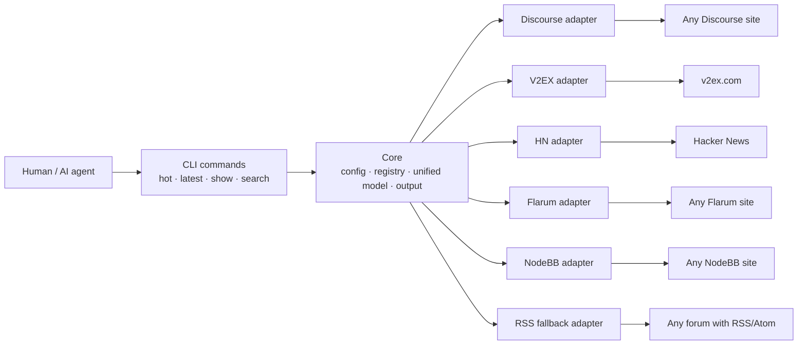

# fora — Specification v1

> Status: **living document** — this spec lives in the repo root next to
> `README.md`. Any PR that changes behaviour described here must update
> this file in the same PR. When v1 ships, this file is frozen as the v1
> record and design discussion moves to `docs/`.

> Name: **fora** — the Latin plural of *forum*, "many forums" (decided by
> Ma, 2026-11-26). Binary: `fora`. npm package: `fora-cli` (the bare
> `fora` package name is taken by an unrelated framework). Repo:
> `github.com/isaced/fora`.
> License: **MIT** (decided by Ma, 2026-11-26).
> Language: **TypeScript on Bun**. Distributed two ways: an npm package
> (`bunx fora-cli` / `npm i -g fora-cli`) and a single-file binary built
> with `bun build --compile`. Bun APIs (`Bun.file`, `bun:sqlite`, …) may be
> used anywhere they are the better tool — the project targets Bun as its
> runtime, full stop; Node portability is not a goal.

## 1. What this is

A read-only command-line client that reads many different forums through **one
unified interface**. It is **agent-first, human-friendly**: the CLI contract is
designed for programmatic consumption first, and the human-facing output is a
readable view on top of the same contract.

- **AI agents** need clean, structured forum data (`--json` on every command),
  predictable errors and low token cost — they are the primary audience.
- **Humans** in a terminal get readable defaults instead of N browser tabs.

The design follows the yt-dlp lesson: a small core, a **unified data model**,
and **engine adapters** (plugins) that translate each forum platform's API
into that model. It is *not* a generic web fetcher — fetching is a solved
problem (curl, Firecrawl, Jina). The value of this tool is **semantic
normalisation**: knowing which field is the title, which is the reply count,
who the author is, across every supported forum.

### 1.1 Design principles

1. **Agent-first.** Commands, flags, output, errors and help are designed for
   programmatic access: stable `--json`, structured `{code, message}` errors,
   meaningful exit codes, no interactive prompts in non-TTY mode, and
   copy-pasteable Examples in every help page. A single call replaces
   agent-side loops; humans get readable output for free.
2. **API-first, never HTML scraping.** Every adapter talks to a documented or
   de-facto-stable JSON API. Forums without an API are served only by the RSS
   fallback adapter (limited capability, clearly flagged).
3. **Adapters are per *engine*, sites are data.** A Discourse adapter serves
   linux.do and every other Discourse instance on earth; a site is just
   `{name, base_url, engine}` in config. Adding a site is usually zero code.
4. **Read-only in v1.** No posting, replying, liking, or login-walled content.
5. **Polite by default.** Identifiable User-Agent, request pacing, no
   retry-loops against rate limits (see §9).
6. **Efficient and cost-aware.** `digest` returns a whole briefing in one
   payload with bounded global concurrency; `--fields`, excerpts, top-N replies
   and declared truncation keep token spend predictable (§6.2).
7. **Stateless core.** fora keeps no runtime state that affects what its
   output *means*: same command + same upstream data ⇒ same output, safe to
   run in parallel, in cron, in sandboxes. History and dedup belong to the
   agent layer (agents have their own memory). The only file besides config
   is the last-list **cache** (§6.1 rule 1) — a cache, not state: deleting
   it loses a convenience, never correctness.

## 2. Architecture



Repository layout:

```
src/cli.ts            entry point
src/core/             unified model, adapter registry + loader, config, errors
src/output/           human table renderer + JSON renderer
src/adapters/
  discourse/          index.ts + fixtures/
  v2ex/               index.ts + fixtures/
  hn/                 index.ts + fixtures/
  flarum/             index.ts + fixtures/
  nodebb/             index.ts + fixtures/
  rss/                index.ts + fixtures/
```

## 3. Unified data model

All adapters return these types. Fields marked optional may be absent when the
source does not provide them; adapters must not invent values.

```jsonc
// Topic — a thread in a list view
{
  "id": "12345",              // source-native id, string
  "site": "linuxdo",          // configured site name
  "title": "string",
  "url": "https://…",         // canonical web URL
  "author": { "username": "…", "display_name": "…", "avatar_url": "…" },
  "category": { "id": "…", "name": "…" },        // optional
  "tags": ["…"],                                  // optional
  "reply_count": 42,                              // optional
  "view_count": 1000,                             // optional
  "like_count": 7,                                // optional
  "created_at": "2026-11-26T08:00:00Z",           // RFC 3339, UTC
  "last_activity_at": "2026-11-26T08:30:00Z",     // RFC 3339, UTC
  "excerpt": "first ~200 chars of the first post, plain text",  // optional
  "pinned": false
}

// Post — one floor inside a topic
{
  "id": "…", "topic_id": "…", "floor": 1,
  "author": { "username": "…" },
  "content_text": "plain text",
  "content_html": "…",        // as provided by the source, optional
  "created_at": "…", "like_count": 0
}

// TopicDetail = Topic + { "posts": [Post], "post_count": n,
//                         "page": 1, "pages": 3 }

// Category { "id", "name", "slug", "description", "topic_count" }
```

## 4. Adapter (plugin) contract

An engine adapter is a TypeScript module whose default export satisfies:

```ts
export interface Adapter {
  engine: string                       // "discourse", "v2ex", …
  capabilities: Capabilities           // which ops are supported
  detect(site: SiteCandidate): Promise<boolean>   // fingerprint a URL
  hot(site: Site, opts: ListOpts & { period?: Period }): Promise<Topic[]>
  latest(site: Site, opts: ListOpts): Promise<Topic[]>
  topic(site: Site, ref: string, page: number): Promise<TopicDetail>
  search(site: Site, query: string, opts: ListOpts): Promise<Topic[]>
  categories(site: Site): Promise<Category[]>
}

export interface Capabilities {
  hot: boolean; latest: boolean; hotPeriods: boolean  // hot accepts --period
  topic: boolean; search: boolean; categories: boolean
}
```

Rules for adapters:

- Unsupported operation ⇒ return `ErrUnsupported` (the CLI renders
  "not supported by <engine>" and exits non-zero), never fake data.
- All timestamps normalised to UTC RFC 3339. All HTML converted to plain text
  for `content_text`/`excerpt` (strip tags, decode entities, collapse
  whitespace).
- Built-in adapters live **in-tree**, one directory per engine, registered in
  one central list in `src/core`.
- **External adapters (the reason this project is TypeScript):** the core
  loader also imports adapters at runtime via dynamic `import()` from
  (a) single files in `~/.config/fora/adapters/*.ts|js`, and
  (b) installed npm packages named `fora-adapter-<engine>`. An external
  adapter is just a module with the default export above — no SDK, no build
  step. The contract is designed for this from day one; the loader itself
  ships in M2 (see §11). External adapters run with the user's privileges:
  document clearly that users should only install adapters they trust,
  exactly like shell or editor plugins.
- Every adapter ships **recorded fixtures** (real API responses, personal
  data removed) under its `fixtures/`, plus tests proving hot/latest/topic
  produce well-formed model objects from those fixtures. A shared contract
  test in `src/core` runs the same assertions against every adapter,
  built-in or external.
- A contributor-facing `docs/writing-an-adapter.md` documents this contract
  with the HN adapter as the worked example (it is the simplest).

## 5. Sites and configuration

Config file: `$XDG_CONFIG_HOME/fora/config.yaml`
(fallback `~/.config/fora/config.yaml`).

```yaml
default_site: v2ex
sites:
  - name: v2ex
    engine: v2ex
    base_url: https://www.v2ex.com
  - name: linuxdo
    engine: discourse
    base_url: https://linux.do
  - name: hn
    engine: hn            # base_url fixed by the adapter
```

Built-in presets (available with zero config): `v2ex`, `linuxdo`, `hn`.

### 5.1 Official site directory

The project maintains a **bundled directory of known forums** in the repo
(`sites.yaml` at the package root, shipped with every release). Each entry
is one line of data — no code:

```yaml
- name: swift-forums        # unique slug, default = domain without TLD
  url: https://forums.swift.org
  engine: discourse
  tags: [swift, apple, en]  # topic / language tags for discovery
```

- Directory sites work out of the box: `fora hot --site swift-forums`,
  no `sites add` needed. `fora sites list` shows directory + user sites
  together, marked by source; `fora sites search <keyword>` searches
  names and tags.
- Lookup order: **user config overrides the directory** on a name clash.
- Contribution path: adding a forum to the directory is a one-line PR —
  deliberately the lowest-barrier contribution in the project (most
  contributors will add sites; few will write engines). CI validates the
  schema, name uniqueness, and that each entry's `engine` matches what
  `Detect` reports for its URL.
- Seed criteria: notable, public, actively-running forums on supported
  engines (official project communities first — e.g. Swift Forums, Rust
  Discourse, Go forum, Discourse Meta, linux.do). Quality over quantity;
  target ~30 entries at v0.1.0.
- The directory ships bundled and updates with releases. A remote
  `sites update` command is a Later item (§13), not v1.

`fora sites add <url>` probes the URL with each adapter's `Detect`
(Discourse: `GET /site.json`; Flarum: `GET /api`; NodeBB: `GET /api/config`;
V2EX: host match + `GET /api/nodes/all.json`), reports the detected engine,
and appends the site to config after confirmation (auto-confirm with `--yes`,
required in non-TTY mode).

### 5.2 Follow list and filters (agent personalisation)

```yaml
follow: [v2ex, linuxdo]          # sites included in `fora digest`
sites:
  - name: v2ex
    engine: v2ex
    base_url: https://www.v2ex.com
    include_nodes: [programmer, tech]        # optional allowlist
  - name: linuxdo
    engine: discourse
    base_url: https://linux.do
    include_categories: [开发调优]            # optional allowlist
```

Personalisation lives in config, not in the agent's prompt: the agent runs
the same `fora digest` every day and the tool applies the human's choices.
Filters are allowlists over the engine's native section concept (V2EX
nodes, Discourse categories, Flarum tags); engines without native section
filtering apply them client-side on the unified `category` field.

## 6. Command surface

**Framework: [citty](https://github.com/unjs/citty)** (UnJS; TypeScript-first,
zero dependencies, ~52 KB, lazy subcommands, actively maintained). Chosen
over: Commander (fine default, but weaker TS inference and older API style),
oclif (built for command-plugin marketplaces — our plugins are *adapters*
loaded by our own loader, §4, so its machinery buys nothing and costs
~130 ms startup and ~18 dependencies), Clipanion (unmaintained since 2024),
cac (admirably tiny, but flatter command model and poorer help output).
Interactive prompts (only `sites add` confirmation) use **@clack/prompts**,
and only in a TTY.

### 6.1 Design principles — learned from cf, Vercel CLI, agent-browser, gh

1. **Addressable results (from agent-browser).** List commands number their
   results, and the most recent list is cached in
   `$XDG_CACHE_HOME/fora/last-list.json`. `fora show 3` then opens the
   3rd topic of the last list — for humans *and* agents, the common flow
   "list → pick one" must not require copying ids or URLs around. This
   cache is the single exception to the stateless core (§1.1 rule 6): it
   lives in the cache directory precisely because deleting it must never
   change what any output means — `show 3` just asks for a fresh list.
2. **JSON is a first-class citizen (from cf).** `--json` on every command
   with a stable schema (§3); errors in JSON mode are structured
   (`{code, message}`) on stderr. Human output is the TTY default; the data
   is never locked inside the table rendering.
3. **Discoverability (from cf).** `fora engines list` and complete,
   consistent `--help` on every command, each with one concrete example.
   An agent should be able to learn the whole tool from `--help` alone.
4. **Errors that teach (from Vercel CLI).** Unknown site ⇒ print the known
   sites and the `sites add` command. Mistyped command ⇒ "did you mean".
   Missing required input in a TTY ⇒ prompt for it (@clack/prompts);
   in non-TTY ⇒ usage error, exit 2.
5. **Consistency (from gh).** Same global flags everywhere (`--json`,
   `--site`, `-n`), same flag names for the same concept, meaningful exit
   codes (§6), no command inventing its own conventions.
6. **The positional is the primary subject.** Each command takes at most one
   positional, and it is always the obvious thing: for list commands the
   *site* (`fora hot linuxdo`), for `search` the *query*, for `show` the
   *topic*. Humans get the short form; the explicit `--site` flag always
   works too and is the form docs and agents should use. No hidden state:
   site resolution order is flag → positional → `FORA_SITE` env →
   `default_site` config. If none of these yields a site, fora exits 2 with
   the known sites rather than guessing. Nothing is "sticky" between runs (the last-list
   numbers of rule 1 are the one sanctioned exception, and `--json` list
   output always carries the stable `id` alongside the number).
7. **Piped output is full output.** When stdout is not a TTY: no colour, no
   truncation (full titles), no prompts. Truncation is a display choice for
   interactive terminals only, never a data loss for pipes or agents.

```
fora                             # prints help (use `fora hot` for the default site)
fora digest  [--since 24h] [--per-site 10] [--top-replies 3]   # §6.2, the agent flagship
fora hot     [site] [--site <name|all|a,b>] [--period day|week|month|all] [-n 20]
fora latest  [site] [--site <name|all|a,b>] [-n 20]
fora show    <topic-ref...> [--page N] [--all-pages] [--replies N] [--excerpt]
fora search  <query…> [--site <name>]
fora categories [site] [--site <name>]
fora sites   list | add <url> | remove <name> | search <keyword>
fora engines list                      # engines + capabilities matrix
```

Two list verbs only — **hot** (ranked by engagement; `--period` selects the
ranking window where the engine supports it) and **latest** (chronological).
There is no separate `top` command: Discourse `/top`, HN top stories and
NodeBB popular are all just their engine's `hot`. Fewer concepts for users
to learn, one less method in the adapter contract (§4).

Global flags: `--json`, `--limit/-n`, `--site`.

Behaviour notes:

- `show` accepts a pasted web URL from any configured engine (parse the id
  from the URL) — this is the most common agent workflow. It also accepts a
  bare number, resolved against the last list per §6.1 rule 1. If the URL's
  site is not configured but its engine is recognised, resolve it
  ephemerally without writing config (§6.2).
- `--site all` (hot/latest only): query every configured site, output grouped
  by site in human mode; in `--json` mode a flat array with the `site` field
  set. One site failing must not fail the whole command — report the failure
  on stderr, exit 0 if at least one site succeeded. `--site a,b` queries an
  ad-hoc subset with the same semantics.
- Human output: compact table — index, title (truncated to terminal width),
  author, replies/views, relative time, category. `show` prints posts as
  `#<floor> @<user> · <relative time>` followed by wrapped plain text.
- Exit codes: `0` ok · `1` generic error · `2` usage error ·
  `3` unsupported operation · `4` rate-limited / upstream refusal.

### 6.2 Agent-first provisions

The reference workload is the **scheduled briefing**: once a day the agent
runs **one** command and receives everything needed to write a summary —
no per-site loops, no per-topic follow-up calls, no dedup homework.

- **`fora digest`** returns, in a single payload, every followed site's
  (§5.2) current hot topics, each with the OP excerpt and the top N replies
  by likes (`--top-replies`, default 3), grouped by site. Site and topic
  detail fetches share one bounded global pool (5 in flight); HttpClient
  still enforces the ≥300ms gap per host (§9).
- **Incremental without state.** `--since <duration>` (e.g. `24h`)
  restricts digest/hot/latest to topics created or last active inside the
  window, computed purely from the timestamps the APIs already return —
  no seen-store, no `new` flags (§1.1 rule 6). A topic still drawing
  replies inside the window legitimately reappears: it is still news.
  Agents that need exact cross-run dedup keep the returned topic ids in
  their own memory — that is the agent layer's job, and agents already
  have memory systems for it.
- **Token economy** — context is the agent's scarce resource:
  - `--fields a,b,c` on list/digest commands (gh-style): return only the
    named model fields.
  - Excerpts by default; full post text only with `--full`.
  - Replies are highlights (top by likes), never whole threads, unless
    `show --all-pages` is explicitly requested.
  - **Truncation is always declared** in the payload (`"truncated": true`,
    `"omitted_replies": 41`), never silent.
  - Every JSON payload carries `"meta": {"approx_tokens": n}` so the agent
    can budget before reading further.
- **A stable, self-describing contract.** All `--json` output uses an
  envelope: `{"schema": "fora/v1", "data": …, "meta": {…}}`, where `data`
  is the §3 model. `fora engines list --json` and `fora sites list --json`
  give a machine-readable capability matrix to plan with — no
  trial-and-error calls. `fora schema` and `fora help <command> --json`
  expose commands, flags and fields; `fora skills get core` ships a
  version-matched one-page guide. `fora doctor --json` reports per-site
  reachability, active route (`http` / `browser` / `rss`) and loaded
  engines as a pre-flight check.
- **CLI-first is deliberate.** Agents with shell access (Muse, pi,
  Claude Code, …) drive CLIs natively — the agent-browser precedent. An
  MCP wrapper may come later (§13) but is not the primary interface.

## 7. v1 adapters — endpoints

Four of these are **reference adapters** — each exists to demonstrate one
pattern for future contributors, and each must be exemplary in code,
fixtures and docs:

| Adapter | Pattern it demonstrates |
|---|---|
| Discourse | The engine multiplier — one adapter, thousands of sites |
| Hacker News | The simplest adapter — the `writing-an-adapter.md` tutorial example; two APIs composed (Firebase + Algolia), tree comments |
| V2EX | A beloved single site on a quirky legacy API, kept clean |
| Flarum | The modern standard — JSON:API with relationship resolution |


### 7.1 Discourse (engine; serves most Discourse sites)

- Hot = `GET /top.json?period=<period>` (default period `daily`)
- Latest = `GET /latest.json`
- Topic = `GET /t/{id}.json` (posts from `post_stream.posts`; page via
  `post_ids` chunking only if simple — v1 may return the first chunk plus
  `pages` estimate; document the limitation)
- Search = `GET /search.json?q=`
- Categories = `GET /categories.json`; site info = `GET /site.json`
- Embedded `users` array in list responses maps poster ids to usernames.
- Every `discourse` site uses a JSON-first auto adapter: on an HTTP 403
  HTTP 403 it retries via §7.1a and reports the downgrade in output.

### 7.1a Discourse RSS (engine; feed-backed Discourse sites)

Some Discourse instances (notably linux.do) answer `/latest.json` and
`/top.json` with an HTTP 403 while leaving their feeds readable. This engine keeps the same Topic mapping as §7.1 but reads feeds:

- Hot = `GET /top.rss?period=<daily|weekly|monthly>` (`all` omits `period`; default `daily`)
- Latest = `GET /latest.rss`
- Topic = find the item in the recent feeds and return `content:encoded` as one post
- Search/Categories: unsupported (exit 3)
- Engagement metrics are omitted because Discourse feeds do not carry them.
- Detection: `/site.json` identifies Discourse; a challenged `/latest.json`
  selects this transport instead of the JSON one.
- When used as a fallback, JSON output carries `meta.degraded_sites` with
  `from`, `to`, `reason` and `limitations`; human output prints a warning.
  `fora doctor` reports the active `route` (`json` or `rss`) per site.
  A fallback cannot rescue an IP that is blocked at the feed layer too.

### 7.2 V2EX (single-site engine)

- Hot = `GET /api/topics/hot.json`; Latest = `GET /api/topics/latest.json`
- Topic = `GET /api/topics/show.json?id=` + replies from
  `GET /api/replies/show.json?topic_id=&page=`
- Categories = nodes: `GET /api/nodes/all.json`
- **Search: not available in the public v1 API ⇒ capability off.**
- `--period` on hot: not available ⇒ unsupported error (do not fake other
  windows from the hot list).
- Content: prefer `content_rendered` → derive text; fall back to `content`.

### 7.3 Hacker News

- Top = Firebase `GET /v0/topstories.json` then item details
  (`/v0/item/{id}.json`), first N items, fetched concurrently (max 8 in
  flight). Hot = same as Top. Latest = `/v0/newstories.json`.
- Topic = item + comment tree from `kids`, flattened in order, depth-first,
  `--all-pages` ignored; cap comments at 200 with a truncation note.
- Search = Algolia `GET https://hn.algolia.com/api/v1/search?query=&tags=story`
- Categories: unsupported.

### 7.4 Flarum (engine)

- Latest = `GET /api/discussions?sort=-lastPostedAt&include=user,firstPost`
- Hot = `GET /api/discussions?sort=-commentCount` (approximation — document it)
- Topic = `GET /api/discussions/{id}?include=posts,posts.user`
- Search = `GET /api/discussions?filter[q]=`
- Categories = tags: `GET /api/tags`
- JSON:API decoding: resolve `included` relationships by type+id.

### 7.5 NodeBB (engine)

- Latest = `GET /api/recent`; Hot = `GET /api/popular?term=<daily|weekly|monthly|alltime>`
  (period maps to the term)
- Topic = `GET /api/topic/{slug}` (accept numeric id by resolving slug via
  `/api/topic/{tid}` redirect target if needed — otherwise require URL form)
- Search = `GET /api/search?term=`
- Categories = `GET /api/categories`

### 7.5a Generic browser fallback

Any adapter using `HttpClient` retries any HTTP 403 on a public read once through
`agent-browser --headed`, reusing one named session per origin. The request URL
is unchanged, so mappings stay identical; the downgrade is recorded as
`http → browser` with limitations (`requires agent-browser`, `slower`,
`needs headed browser`). Disable with `FORA_BROWSER_FALLBACK=0`. If the browser
transport fails or is unavailable, the original 403 is returned to the adapter,
which may then apply its own endpoint fallback (e.g. §7.1a).

### 7.6 RSS fallback (any forum with a feed)

- Input: a feed URL configured as a site (`engine: rss`, `base_url` = feed URL,
  optional `site_url` for display).
- Latest = feed items mapped to Topics (title, link, author, published,
  excerpt from description). Hot/Top/Search/Categories: unsupported.
  Topic: return the item's full `content:encoded` as a single post if
  present, else unsupported.
- Support RSS 2.0 and Atom. This adapter is the documented long-tail net for
  phpBB / Discuz! / SMF forums that expose feeds.

### 7.7 Ruby China (Homeland v3 API)

- Hot = `GET /api/v3/topics.json?type=popular&limit=<n>`
- Latest = `GET /api/v3/topics.json?type=recent&limit=<n>`
- Topic = `GET /api/v3/topics/:id.json` plus
  `GET /api/v3/topics/:id/replies.json?offset=&limit=50`
- Categories = nodes: `GET /api/v3/nodes.json`
- Search: no documented public endpoint ⇒ unsupported (exit 3).
- `--period` on hot: no time-window endpoint ⇒ unsupported.
- `excellent` is exposed as `tags: ["excellent"]`, never as `pinned`.

## 8. Explicitly out of scope for v1

- Posting, replying, liking, voting, notifications, private messages.
- Login-walled or trust-level-gated content; cookies/sessions.
- HTML-scraping adapters for phpBB / vBulletin / Discuz! / XenForo
  (XenForo's official API requires admin-issued keys end users cannot get).
- Custom one-off forum systems with no API — e.g. **TMDB Talk**
  (themoviedb.org/talk): a bespoke in-house board, website HTML only (the
  TMDB API covers movie/TV data, not discussions), and a support queue
  with no hot/ranking semantics. Supporting it would mean a single-site
  scraping adapter — exactly the pattern this project exists to replace.
  Deliberately excluded from core; it is the documented boundary case.
  If anyone ever supports it, it belongs in an **external** adapter
  (`fora-adapter-tmdbtalk`, §4) owned by whoever cares about it — the
  plugin mechanism is the sanctioned escape hatch for exceptions, so the
  core never has to bend its rules for them.
- Reddit (API is approval-gated).
- TUI/full-screen mode (plain CLI output only; TUI is a v2 candidate).
- Persistent caching (in-memory only within a single invocation).

## 9. Etiquette and robustness

- User-Agent: `fora/<version> (+https://github.com/isaced/fora)`.
- Pace requests: ≥300 ms between requests to the same host (except HN item
  fan-out, which uses the official API designed for it, still capped).
- On HTTP 429 or a block page: **stop, report, exit 4**. Never retry-loop,
  rotate identities, or try to bypass Cloudflare/anti-bot measures.
- On 5xx: at most 2 retries with backoff. Timeouts: 15 s per request.
- If linux.do (Cloudflare-fronted) refuses API access from some networks,
  surface that plainly — do not engineer around it.

## 10. Testing

- `bun test` must pass offline: adapter tests run on fixtures only.
- Contract test: every registered adapter is exercised against its fixtures
  for each capability it claims.
- Golden-file tests for the human table renderer and `--json` shape.
- Type check: `tsc --noEmit` clean.
- CI: GitHub Actions — install Bun, `bun test`, `tsc --noEmit`, and a
  `bun build --compile` smoke build on push/PR.

## 11. Milestones

- **M1 — Core + proof**: core model/registry/config/output; Discourse, V2EX,
  HN adapters; `hot/latest/show/search/categories/sites` commands;
  fixtures + contract tests; the official site directory (§5.1) seeded
  with the three presets plus the major Discourse community forums.
  *This alone covers linux.do + V2EX + HN.*
- **M2 — Engine breadth + plugin loader + agent layer**: Flarum, NodeBB,
  RSS adapters; `sites add` engine auto-detection; `engines list`; the
  external-adapter loader (config-dir files + `fora-adapter-*` npm
  packages, §4); `fora digest` with the follow list and the
  `--since`/`--fields`/`--top-replies` token controls (§5.2, §6.2).
- **M3 — Release polish**: README with the coverage story ("linux.do, V2EX
  and HN out of the box; any Discourse/Flarum/NodeBB forum by URL"),
  `docs/writing-an-adapter.md`, a `fora create-adapter` scaffolding
  command that generates a new adapter from a template, distribution via
  npm + `bun build --compile` binaries on GitHub Releases + Homebrew tap,
  v0.1.0 tag.

## 12. v1 acceptance criteria

1. Fresh machine, zero config: `fora hot --site v2ex` returns V2EX hot topics;
   `fora hot` without a site exits 2 and points at `--site`;
   `fora hot --site linuxdo` and `fora hot --site hn` work.
2. `fora show <pasted V2EX or linux.do topic URL>` prints the OP and
   replies in readable plain text; `--json` validates against §3.
3. `fora sites add https://meta.discourse.org` detects Discourse and the
   site is immediately readable — demonstrating the engine multiplier.
   A directory site (§5.1) such as `fora hot --site swift-forums` works
   with no `sites add` at all.
4. Every command honours `--json`; unsupported operations exit 3 with a
   clear message (e.g. `fora search --site v2ex`).
5. Test suite passes fully offline; no test hits the network.
6. Rate-limit behaviour per §9 is implemented and covered by a unit test
   with a stub server returning 429.
7. After `fora hot`, running `fora show 2` opens the second topic of that
   list (§6.1 rule 1); after a different list runs, the numbers rebind to
   the new list.
8. `fora hot linuxdo` and `fora hot --site linuxdo` return identical
   results; bare `fora` prints help, and `fora hot` lists the default site;
   `fora hot --site v2ex --period week` exits 3 (unsupported) rather than
   faking a weekly list.
9. `fora digest --json` in one call returns every followed site's hot
   topics with OP excerpts, top replies and `meta.approx_tokens`, inside
   the `fora/v1` envelope. `fora digest --since 24h` excludes topics whose
   creation and last activity both predate the window, using only API
   timestamps (no state files are read or written besides config and the
   last-list cache). `fora digest --fields title,url` returns topic
   objects carrying only those fields (plus `site`).

## 13. Later (not v1, do not build now)

- V2EX API 2.0 personal-token support (notifications) — first authenticated
  feature, v1.1 candidate.
- Additional engines by community PR: XenForo (if a user-key path emerges),
  phpBB scraping adapter, Lemmy, GitHub Discussions.
- Optional MCP server wrapper exposing the same operations to agents.
- TUI reader.
- Browser-cookie import (`--cookies-from-browser`, the yt-dlp pattern) so
  a user can lend fora their *own* logged-in browser session for sites
  that gate anonymous clients. The only sanctioned answer to bot walls:
  the user's own session, never forged fingerprints or challenge-solving.
